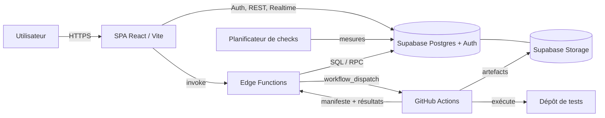
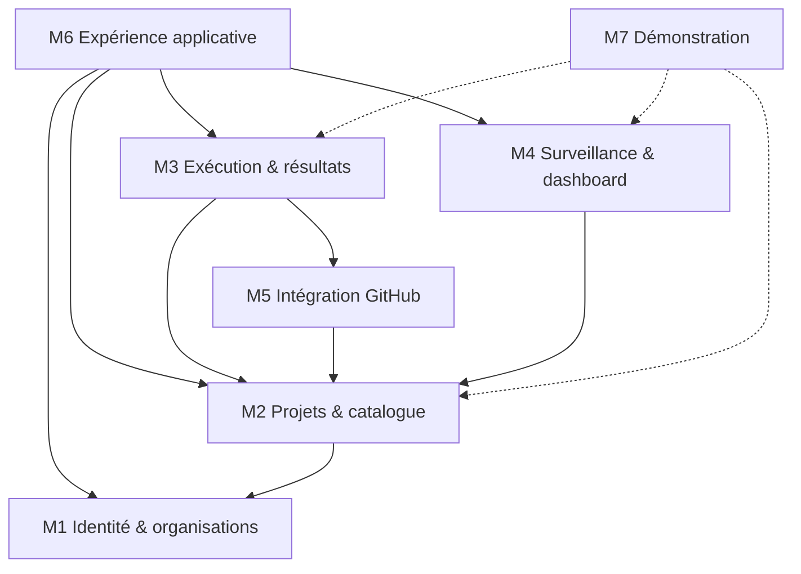
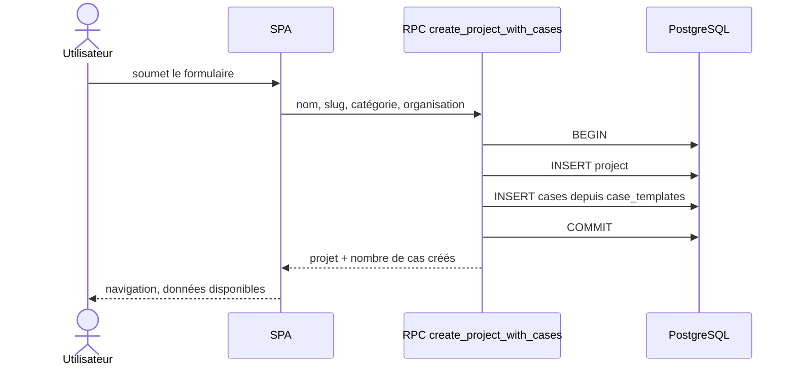
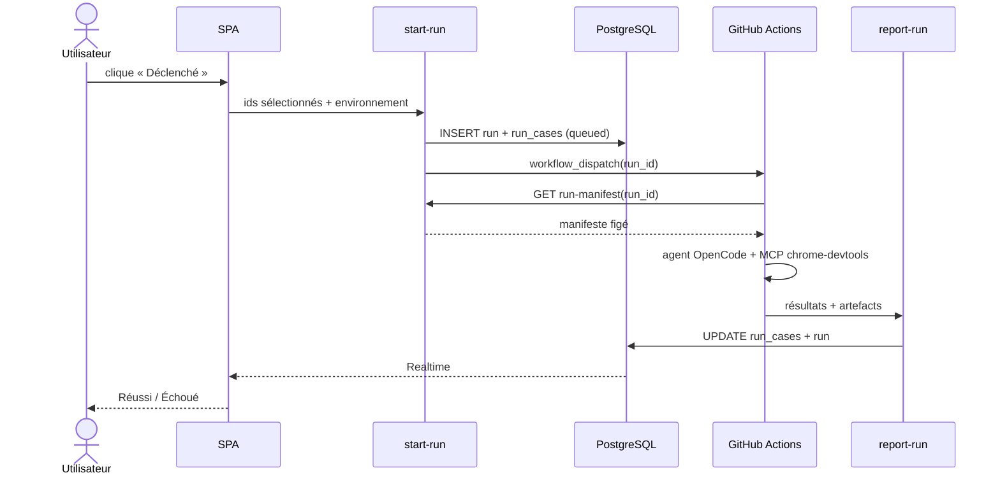
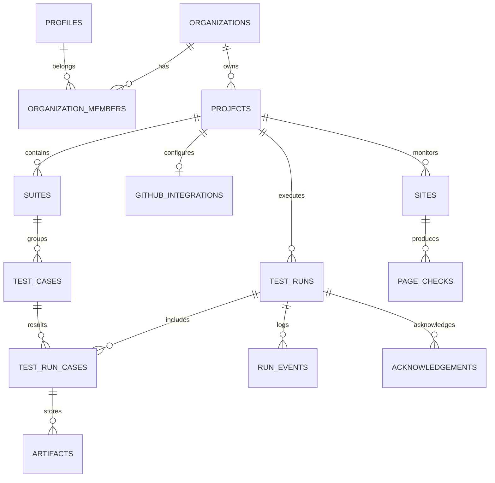
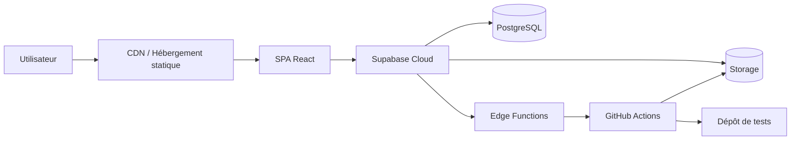

# TestDino-like

## Document d’architecture logicielle

**Version :** 0.1 — brouillon de travail  
**Date :** 22 octobre 2026  
**Auteurs / équipe projet :** à compléter  
**Nature :** architecture cible V2 (Supabase + GitHub Actions), avec état des lieux de la V1 locale

> **Légende des statuts**
>
> - ✅ **Implémenté** dans la V1 locale.
> - 🔶 **Partiel / simulé** dans la V1.
> - ⏳ **Cible V2**, à implémenter avec Supabase et GitHub Actions.

---

> **Note d'implémentation (22 octobre 2026)** : ce document est une proposition
> initiale. Le schéma réellement utilisé est celui de la base Supabase existante
> (`sites`, `test_plans`, `test_cases`, `test_runs`, etc.), documenté dans
> [`supabase/README.md`](../supabase/README.md). L'exécution n'utilise pas Playwright
> comme runner : un agent QA **OpenCode + MCP `chrome-devtools`** pilote Chrome et
> produit `qa_result.json`. Les mentions de Playwright ci-dessous sont historiques.

---

## 1. Contexte et objectifs

### 1.1 Contexte général

**TestDino-like** est une application web de gestion de la qualité logicielle et de surveillance de sites. Elle reprend les principaux parcours d’usage d’une plateforme de test management :

- organiser les tests par organisation, projet, suite et cas de test ;
- déclencher des exécutions automatisées ;
- consulter l’historique des runs et les résultats détaillés ;
- suivre des indicateurs de santé (checks UP/DOWN, temps de chargement, certificats SSL) ;
- conserver les preuves d’exécution (captures, traces, messages d’erreur).

La V1 actuelle est une application **React + Vite + Tailwind**, en français, avec un jeu de données de démonstration. Elle permet de valider l’UX, les écrans, les filtres, les drawers et les parcours de sélection. En revanche, elle ne dispose pas encore de backend : les projets et l’organisation sont stockés dans `sessionStorage`, les runs sont statiques, et le déclenchement est simulé pendant 10 secondes.

La cible V2 ajoute une persistance réelle avec **Supabase** et une exécution réelle avec **GitHub Actions**. L’application ne doit pas exécuter les tests elle-même : elle orchestre, trace et affiche. Les tests restent dans un dépôt GitHub, où le workflow YAML existe déjà.

### 1.2 Objectifs du système

1. **Centraliser le catalogue de tests** : projets, suites, cas de test, priorités, statuts et tags d’automatisation.
2. **Créer un projet de façon atomique** : le projet et son pack de cas de test sont enregistrés dans la même transaction.
3. **Déclencher une sélection de cas** sur GitHub Actions, sans exposer de token GitHub au navigateur.
4. **Suivre l’exécution en temps réel** : en file d’attente, en cours, réussi ou échoué.
5. **Conserver les résultats et les preuves** par run et par cas de test.
6. **Afficher un dashboard de surveillance** cohérent avec la période sélectionnée.
7. **Isoler strictement les données de démonstration** des données des projets réels.
8. **Préparer un modèle multi-organisations** avec authentification, rôles et RLS.

### 1.3 Périmètre de la version

**Inclus dans le MVP V2 :**

- authentification Supabase et création d’organisation ;
- création de projet avec copie d’un pack de cas de test selon la catégorie ;
- catalogue de cas de test éditable (création, modification, suppression, déplacement) ;
- connexion d’un projet à un dépôt GitHub et à un workflow ;
- déclenchement d’une sélection de cas automatisés ;
- réception des résultats et des artefacts ;
- historique des runs, filtres, tiroir de résultats et acquittement ;
- dashboard de surveillance alimenté par des données réelles ;
- maintien du projet `DemoProject` comme sandbox en lecture seule.

**Explicitement hors périmètre :**

- facturation et gestion des abonnements ;
- SSO/SAML entreprise ;
- application mobile native ;
- insights IA et analyse de flakiness avancée ;
- exécution des tests dans le navigateur ;
- support multi-CI (GitLab, Bitbucket, Jenkins) dans un premier temps ;
- monitoring multi-régions et haute disponibilité ;
- génération automatique de code de test à partir des cas métier.

---

## 2. Exigences fonctionnelles et non fonctionnelles

### 2.1 Exigences fonctionnelles (vue macro)

| ID | Fonctionnalité | Statut V1 | Cible V2 |
| --- | --- | --- | --- |
| F1 | Créer une organisation et inviter des membres | 🔶 écran d’onboarding | Supabase Auth + organisations + rôles |
| F2 | Créer, modifier et supprimer des projets | 🔶 `sessionStorage` | table `projects`, RPC atomique |
| F3 | Attribuer un pack de cas de test à un projet | ✅ packs générés côté client | `case_templates` + copie serveur |
| F4 | Gérer les suites et les cas de test | ✅ édition inline, drag & drop | persistance Supabase + RLS |
| F5 | Sélectionner des cas et déclencher une exécution | 🔶 simulation 10 s | Edge Function + GitHub Actions |
| F6 | Consulter l’historique et les filtres des runs | 🔶 données statiques | `test_runs`, Realtime, pagination serveur |
| F7 | Ouvrir un run et acquitter les échecs | ✅ tiroir et cartes | persistance des acquittements |
| F8 | Afficher les KPI et la tendance | 🔶 données de démo | `sites`, `page_checks`, agrégats |
| F9 | Isoler la démo des projets réels | ✅ garde `DemoProject` | même garde, côté données |
| F10 | Connecter un dépôt GitHub et un workflow | ⏳ non implémenté | `github_integrations`, test de connexion |
| F11 | Recevoir les résultats et les preuves | ⏳ non implémenté | `report-run`, Supabase Storage |
| F12 | Afficher des squelettes de chargement | ⏳ à généraliser | React Query / états de chargement |

### 2.2 Exigences non fonctionnelles

| Domaine | Exigence | Cible |
| --- | --- | --- |
| Performance | Chargement initial de l’application | < 2 s sur 4G |
| Performance | Navigation entre vues | < 300 ms perçu |
| Performance | Création d’un projet + 50 cas | < 2 s |
| Performance | Accusé de réception du déclenchement | < 3 s |
| Performance | Propagation d’un résultat via Realtime | < 2 s |
| Sécurité | Authentification | Supabase Auth, JWT |
| Sécurité | Autorisation | RLS + contrôle d’appartenance à l’organisation |
| Sécurité | Secrets | Aucun token GitHub ou service_role dans le client |
| Sécurité | Audit | `run_events`, journal des actions sensibles |
| Disponibilité | Objectif de service | 99,5 % (hors indisponibilité GitHub/Supabase) |
| Fiabilité | Déclenchement | idempotent, rejouable, sans doublon |
| Ergonomie | Interface | responsive, clavier, contrastes, français |
| Maintenabilité | Découpage | modules, services, migrations versionnées |
| Observabilité | Diagnostic | logs Edge Functions, événements de run, erreurs GitHub |

---

## 3. Acteurs et vue d’utilisation

### 3.1 Acteurs du système

| Acteur | Rôle | Ce qu’il vient faire |
| --- | --- | --- |
| **Visiteur** | Non authentifié | Consulter les écrans d’authentification et la démo publique |
| **Utilisateur authentifié** | Membre d’une organisation | Gérer ses projets, cas de test et exécutions |
| **Administrateur d’organisation** | Owner/Admin | Gérer les membres, les rôles et les paramètres de l’organisation |
| **Administrateur de projet** | Responsable d’un projet | Configurer le dépôt GitHub, les environnements et les packs |
| **Système CI (GitHub Actions)** | Acteur machine | Récupérer le manifeste, exécuter les tests, publier les résultats |
| **Planificateur de surveillance** | Acteur machine | Lancer les checks de sites et enregistrer les mesures |
| **Visiteur de la démo** | Utilisateur en sandbox | Explorer `DemoProject` sans modifier les données réelles |

### 3.2 Scénarios d’usage principaux

**Scénario A — Créer un projet et son catalogue**

1. L’utilisateur ouvre le formulaire de création.
2. Il choisit un nom, une catégorie (E-commerce, Application, Blog, Site vitrine, Portfolio, Général) et une organisation.
3. Le serveur crée le projet et copie le pack de cas correspondant dans la même transaction.
4. Le client affiche un état de chargement, puis navigue vers le projet.
5. Les cas de test sont déjà disponibles ; le dashboard et les runs restent vides.

**Scénario B — Déclencher une sélection de cas**

1. L’utilisateur coche plusieurs cas automatisés.
2. Il clique sur **Déclenché**.
3. Le serveur crée un run, puis demande à GitHub Actions de démarrer le workflow.
4. Le workflow récupère le manifeste du run et exécute les tests correspondants.
5. Les résultats remontent dans Supabase ; l’interface passe de « En cours » à « Réussi » ou « Échoué ».

**Scénario C — Analyser un échec**

1. L’utilisateur ouvre un run depuis la liste.
2. Le tiroir affiche les onglets **Réussi** et **Échoué**.
3. Il consulte le message d’erreur, les étapes et les preuves.
4. Il acquitte l’échec ; l’acquittement est enregistré par utilisateur.

**Scénario D — Surveiller un site**

1. Un projet contient des sites actifs.
2. Le planificateur enregistre régulièrement des checks UP/DOWN et des temps de chargement.
3. Le dashboard agrège les données sur 7, 14 ou 30 jours.
4. L’utilisateur change la période et les KPI ainsi que le graphe sont recalculés.

**Scénario E — Explorer la démo**

1. Un visiteur ouvre `DemoProject`.
2. Il consulte les KPI, les 50 runs et les cas de test d’exemple.
3. Les projets réels restent vides et n’héritent jamais des données de démonstration.

### 3.3 User stories (extraits)

- En tant qu’**administrateur d’organisation**, je veux créer un projet et obtenir immédiatement son catalogue de cas, afin de commencer sans configuration manuelle.
- En tant que **testeur**, je veux sélectionner des cas et les déclencher sur GitHub Actions, afin d’exécuter uniquement ce qui m’intéresse.
- En tant que **testeur**, je veux voir les résultats et les preuves d’un échec, afin de diagnostiquer rapidement.
- En tant que **responsable qualité**, je veux suivre les KPI sur une période, afin de détecter une dégradation.
- En tant que **visiteur**, je veux explorer une démo complète, afin d’évaluer le produit sans créer de compte.

---

## 4. Architecture globale du système

### 4.1 Vue d’ensemble



**Blocs principaux :**

- **Interface** : SPA React, responsive, servie en statique.
- **Services applicatifs** : Edge Functions Supabase pour l’orchestration et les appels GitHub.
- **Données** : PostgreSQL Supabase, RLS, migrations SQL, Storage pour les artefacts.
- **Externe** : GitHub Actions et le dépôt de tests, Supabase Auth, éventuel fournisseur d’e-mail.

### 4.2 Principes d’architecture

1. **SPA + BaaS** : pas de serveur applicatif dédié en V2 ; Supabase fournit l’authentification, la base, le stockage, le temps réel et les fonctions serverless.
2. **Séparation présentation / orchestration / persistance** : React ne contient pas de logique privilégiée ; les opérations sensibles passent par des RPC ou des Edge Functions.
3. **Le client ne parle jamais à GitHub** : il appelle `start-run`, qui détient le token et dispatche le workflow.
4. **Création atomique** : le projet et ses cas sont créés par une fonction PostgreSQL transactionnelle.
5. **Exécution asynchrone** : le déclenchement rend la main immédiatement ; l’état réel arrive par Realtime.
6. **Manifeste figé** : chaque run conserve la sélection et la version des cas au moment du déclenchement.
7. **Moindre privilège** : RLS, token GitHub limité au dépôt, token CI révocable.
8. **Démo isolée** : `DemoProject` est un slug réservé ; les données d’exemple ne sont jamais copiées dans un projet réel.

### 4.3 Communication

| Canal | Usage |
| --- | --- |
| HTTPS/JSON | Appels PostgREST, RPC et Edge Functions |
| WebSocket | Supabase Realtime pour les runs et les résultats |
| GitHub REST | `workflow_dispatch`, lecture des workflows |
| Webhook / callback | Le workflow appelle `report-run` à la fin de l’exécution |
| Storage | Téléversement et lecture d’artefacts via URLs signées |

---

## 5. Conception des modules

### 5.1 Vue d’ensemble des modules

| Module | Responsabilité | Statut V1 |
| --- | --- | --- |
| **M1 — Identité, organisations et accès** | Comptes, organisations, membres, rôles, invitations | 🔶 |
| **M2 — Projets et catalogue de tests** | Projets, suites, cas de test, packs, création atomique | ✅/🔶 |
| **M3 — Exécution, résultats et preuves** | Runs, résultats par cas, acquittements, artefacts | 🔶 |
| **M4 — Surveillance et dashboard** | Sites, checks, KPI, tendances | 🔶 |
| **M5 — Intégration GitHub Actions** | Dépôt, workflow, dispatch, manifeste, callback | ⏳ |
| **M6 — Expérience applicative** | Shell, navigation, thème, palette, toasts, skeletons | ✅ |
| **M7 — Démonstration et sandbox** | Jeu de données `DemoProject`, garde d’isolation | ✅ |



### 5.2 Description détaillée des modules

#### 5.2.1 M1 — Identité, organisations et accès

**1. Rôle et responsabilité**

Garantir l’authentification, l’appartenance à une organisation et les droits d’accès. Ce module est la source de vérité pour savoir qui peut voir ou modifier un projet.

**2. Fonctionnalités**

- inscription, connexion, déconnexion ;
- création d’une organisation à l’onboarding ;
- invitation et gestion des membres ;
- rôles `owner`, `admin`, `member` ;
- paramètres de l’organisation ;
- protection des routes et des données par RLS.

**3. Entités**

| Entité | Attributs principaux | Contraintes |
| --- | --- | --- |
| `profiles` | `id` (uuid, PK), `email`, `full_name`, `avatar_url`, `created_at` | `id` = `auth.users.id` |
| `organizations` | `id`, `name`, `slug`, `plan`, `created_at` | slug unique |
| `organization_members` | `organization_id`, `user_id`, `role`, `created_at` | PK composite, rôle enum |
| `invitations` | `id`, `organization_id`, `email`, `role`, `token_hash`, `expires_at`, `accepted_at` | expiration, hash uniquement |

**4. Interfaces exposées**

- Supabase Auth (email/mot de passe, OAuth optionnel) ;
- RPC `create_organization` ;
- PostgREST pour les lectures autorisées ;
- écrans `/auth`, `/auth/signup`, `/onboarding`.

**5. Flux principaux**

Inscription → création d’organisation → invitation éventuelle → accès aux projets. En V1, les écrans d’authentification existent mais ne bloquent pas l’accès ; en V2, un guard de route vérifie la session.

**6. Dépendances**

Aucune dépendance métier. Fournit l’identité et les rôles aux modules M2 à M5.

**7. Règles métier**

- un utilisateur ne voit que les organisations dont il est membre ;
- un `member` ne peut pas gérer les membres ;
- une invitation expirée ou déjà acceptée est invalide ;
- le propriétaire ne peut pas être supprimé sans transfert de propriété.

#### 5.2.2 M2 — Projets et catalogue de tests

**1. Rôle et responsabilité**

Gérer le cycle de vie des projets et le catalogue de cas de test. C’est le module central du produit : il transforme un projet nouvellement créé en un ensemble cohérent de suites et de cas prêts à être sélectionnés.

**2. Fonctionnalités**

- création, modification et suppression de projets ;
- choix de la catégorie et attribution d’un pack par défaut ;
- arborescence de suites ;
- création, édition, suppression et déplacement de cas ;
- recherche et filtrage ;
- sélection unitaire, par suite et globale ;
- calcul des compteurs de couverture.

**3. Entités**

| Entité | Attributs principaux | Contraintes |
| --- | --- | --- |
| `projects` | `id`, `organization_id`, `name`, `slug`, `category`, `created_at` | slug unique par organisation, `DemoProject` réservé |
| `suites` | `id`, `project_id`, `parent_id`, `name`, `position` | parent dans le même projet |
| `test_cases` | `id`, `project_id`, `suite_id`, `external_id`, `title`, `priority`, `status`, `automation_status`, `automation_tag`, `file_path`, `preconditions`, `steps`, `expected_result`, `version` | `external_id` unique par projet |
| `case_templates` | `id`, `category`, `external_id`, `suite_path`, `title`, `priority`, `preconditions`, `steps`, `expected_result`, `version` | modèles globaux, versionnés |

**4. Interfaces exposées**

- RPC `create_project_with_cases` ;
- PostgREST pour la lecture/écriture des projets, suites et cas ;
- écrans `/projects`, `/:project/test-cases` ;
- événements éventuels `project.created`, `case.updated`.

**5. Flux principaux**

**Création atomique :**



**Édition d’un cas :** lecture du cas, modification inline, validation, écriture, rafraîchissement du cache.

**6. Dépendances**

M1 pour l’organisation et les droits. M5 pour connaître l’état d’automatisation des cas. M3 consomme les cas sélectionnés.

**7. Règles métier**

- le slug `DemoProject` est interdit pour un projet réel ;
- la limite du plan est vérifiée côté serveur ;
- la création est idempotente par slug : un double clic ne crée pas deux projets ;
- le pack est copié à la création ; une modification ultérieure du modèle ne modifie pas les projets existants ;
- un cas sans mapping d’automatisation ne peut pas être déclenché ;
- la suppression d’une suite ne doit pas laisser de cas orphelins.

#### 5.2.3 M3 — Exécution, résultats et preuves

**1. Rôle et responsabilité**

Orchestrer le déclenchement, suivre l’état des runs et restituer les résultats par cas. Ce module relie la sélection produit à l’exécution réelle dans GitHub Actions.

**2. Fonctionnalités**

- création d’un run à partir d’une sélection ;
- machine à états `queued → dispatched → running → passed/failed/cancelled/error` ;
- réception des résultats par cas ;
- stockage des messages d’erreur et des artefacts ;
- historique, filtres, pagination ;
- tiroir de résultats avec onglets Réussi/Échoué ;
- acquittement des échecs par utilisateur ;
- mise à jour temps réel.

**3. Entités**

| Entité | Attributs principaux | Contraintes |
| --- | --- | --- |
| `test_runs` | `id`, `project_id`, `status`, `environment`, `ref`, `requested_by`, `manifest_snapshot`, `github_run_id`, `idempotency_key`, `started_at`, `finished_at` | état contrôlé, clé d’idempotence |
| `test_run_cases` | `id`, `run_id`, `test_case_id`, `status`, `duration_ms`, `error_message` | un résultat par cas et par run |
| `run_events` | `id`, `run_id`, `type`, `payload`, `created_at` | journal append-only |
| `acknowledgements` | `run_id`, `user_id`, `acknowledged_at`, `note` | PK composite |
| `artifacts` | `id`, `run_case_id`, `type`, `storage_path`, `size`, `created_at` | chemin privé, URL signée |

**4. Interfaces exposées**

- Edge Function `start-run` (écriture) ;
- Edge Function `run-manifest` (lecture par le CI) ;
- Edge Function `report-run` (écriture par le CI) ;
- Realtime sur `test_runs` et `test_run_cases` ;
- écrans `/:project/test-runs`, tiroir de run.

**5. Flux principaux**

**Déclenchement et retour des résultats :**



**6. Dépendances**

M2 pour les cas et le projet ; M5 pour le dispatch ; M1 pour l’utilisateur qui déclenche et acquitte.

**7. Règles métier**

- seuls les cas `automated` peuvent être déclenchés ;
- deux clics identiques ne créent pas deux runs : clé d’idempotence et contrainte d’unicité ;
- l’UI des runs n’affiche que deux statuts agrégés : **Réussi** et **Échoué** ;
- les statuts intermédiaires du CI sont normalisés avant agrégation ;
- un échec reste « à acquitter » tant que l’utilisateur ne l’a pas marqué comme vu ;
- l’acquittement est propre à chaque utilisateur ;
- les artefacts sont privés et servis par URL signée ;
- un run échoué côté dispatch doit être marqué `error`, pas `failed`.

#### 5.2.4 M4 — Surveillance et dashboard

**1. Rôle et responsabilité**

Fournir une vue de santé des sites surveillés et les indicateurs clés du projet. Ce module est distinct de l’exécution des tests : il mesure la disponibilité et la performance des sites.

**2. Fonctionnalités**

- enregistrement des sites et de leur état ;
- checks UP/DOWN et temps de chargement ;
- suivi des certificats SSL ;
- KPI sur 7/14/30 jours ;
- graphe de tendance des runs ;
- filtre de période et rafraîchissement ;
- états vides pour les projets sans données.

**3. Entités**

| Entité | Attributs principaux | Contraintes |
| --- | --- | --- |
| `sites` | `id`, `project_id`, `url`, `active`, `crawl_acknowledged`, `last_status`, `load_time_ms`, `ssl_days_remaining` | URL valide, projet obligatoire |
| `page_checks` | `id`, `site_id`, `status`, `checked_at` | `status` ∈ {UP, DOWN} |
| `site_incidents` | `id`, `site_id`, `started_at`, `resolved_at`, `cause` | optionnel |

**4. Interfaces exposées**

- PostgREST pour les sites et les checks ;
- Realtime pour les incidents ;
- vue `/:project/dashboard` ;
- planificateur (cron Edge Function ou service externe) pour les checks.

**5. Flux principaux**

Le planificateur interroge les sites actifs, enregistre un check et met à jour `last_status`. Le dashboard agrège les checks de la fenêtre choisie et calcule les KPI.

**6. Dépendances**

M2 pour le projet ; M1 pour les droits. Aucune dépendance à M3.

**7. Règles métier**

- seuls les sites actifs entrent dans les KPI ;
- un site est en incident si `crawl_acknowledged = false` ou `last_status = 'DOWN'` ;
- un certificat est « à surveiller » sous 30 jours ;
- les KPI dépendants de la période sont recalculés ; le nombre de sites actifs et les SSL restent des instantanés ;
- en V1, ces données sont réservées à `DemoProject`.

#### 5.2.5 M5 — Intégration GitHub Actions

**1. Rôle et responsabilité**

Relier un projet à un dépôt et à un workflow, dispatcher les exécutions et authentifier les échanges entre GitHub Actions et Supabase. Ce module est le seul à détenir le token GitHub.

**2. Fonctionnalités**

- configuration du dépôt, du workflow, de la branche et des environnements ;
- test de connexion ;
- dispatch `workflow_dispatch` ;
- génération et lecture du manifeste ;
- réception des résultats ;
- rotation et révocation des tokens CI ;
- journal des dispatchs et des erreurs.

**3. Entités**

| Entité | Attributs principaux | Contraintes |
| --- | --- | --- |
| `github_integrations` | `id`, `project_id`, `owner`, `repo`, `workflow_file`, `default_ref`, `environment_map`, `token_secret_name`, `active` | un actif par projet |
| `ci_tokens` | `id`, `project_id`, `token_hash`, `label`, `last_used_at`, `expires_at`, `revoked_at` | hash uniquement |
| `dispatch_events` | `id`, `run_id`, `github_run_id`, `status`, `request_payload`, `response_status` | audit |

**4. Interfaces exposées**

- GitHub REST `POST /repos/{owner}/{repo}/actions/workflows/{workflow}/dispatches` ;
- Edge Function `start-run` ;
- Edge Function `run-manifest` ;
- Edge Function `report-run` ;
- écran de paramètres du projet.

**5. Flux principaux**

Vérification de la connexion → dispatch → le workflow récupère le manifeste → exécution → callback de résultats. En cas d’échec du dispatch, le run passe en `error` et l’utilisateur peut réessayer.

**6. Dépendances**

M2 pour le projet et les cas ; M3 pour les runs ; M1 pour les droits.

**7. Règles métier**

- le workflow doit exister sur la branche par défaut du dépôt pour être déclenchable ;
- le token GitHub est un token fine-grained limité au dépôt, avec `Actions: write` et `Contents: read` ;
- le token n’est jamais envoyé au navigateur ;
- le token CI est propre au projet, révocable et stocké sous forme de hash ;
- les appels de callback sont authentifiés et limités au run concerné ;
- les erreurs GitHub 401/404/422 sont remontées avec un message actionnable.

#### 5.2.6 M6 — Expérience applicative

**1. Rôle et responsabilité**

Fournir le shell, la navigation, le thème, les composants transverses et les états de chargement. Ce module n’a pas d’entité métier persistée.

**2. Fonctionnalités**

- sidebars organisation et projet ;
- header, fil d’Ariane, palette de commandes ;
- thème clair/sombre ;
- toasts, empty states, skeletons ;
- responsive desktop/mobile ;
- modales de création ;
- formulaires d’authentification.

**3. Entités**

Aucune entité métier. Préférences locales : thème, dernier projet, e-mail mémorisé.

**4. Interfaces exposées**

- routes React ;
- composants partagés (`AppShell`, `Popover`, `Toast`, `EmptyState`) ;
- événements UI locaux.

**5. Flux principaux**

Navigation → chargement de la vue → skeleton si nécessaire → rendu des données → actions utilisateur → toast de confirmation.

**6. Dépendances**

Tous les modules métier pour l’affichage. Aucun module métier ne dépend de M6.

**7. Règles métier**

- l’interface est en français, sauf les écrans d’authentification qui reprennent les libellés anglais de la référence ;
- les écrans d’authentification ne bloquent pas l’accès en V1 ;
- les états vides proposent un lien vers la démo ;
- les skeletons ne reposent pas sur des délais artificiels ;
- l’application reste utilisable au clavier.

#### 5.2.7 M7 — Démonstration et sandbox

**1. Rôle et responsabilité**

Fournir un jeu de données complet et isolé pour découvrir le produit sans backend. Ce module est transverse et volontairement séparé des données réelles.

**2. Fonctionnalités**

- projet `DemoProject` ;
- 50 runs d’exemple et leurs résultats ;
- KPI de surveillance et graphe ;
- cas de test générés par catégorie ;
- palette de commandes limitée à la démo ;
- états vides pour les projets réels.

**3. Entités**

Aucune entité Supabase en V1. Les données sont des modules statiques (`data/runs.js`, `data/sites.js`, `data/casePacks.js`, `data/dashboard.js`). En V2, un indicateur `is_demo` pourra être ajouté, mais le slug reste la garde principale.

**4. Interfaces exposées**

- constante `DEMO_PROJECT_SLUG` ;
- garde `isDemo` dans les vues ;
- lien « Voir la démo » dans les états vides.

**5. Flux principaux**

Sélection du projet de démo → affichage des données statiques. Pour un projet réel, les vues appellent Supabase et affichent un état vide si aucune donnée n’existe.

**6. Dépendances**

M2, M3 et M4 pour les composants d’affichage ; aucune dépendance inverse.

**7. Règles métier**

- `DemoProject` est un slug réservé, impossible à créer ;
- les données de démo ne sont jamais copiées dans un projet réel ;
- la palette ne remonte aucun run de démo hors du projet de démo ;
- les dates de démonstration peuvent être recalées au chargement pour garder les filtres pertinents ;
- la suppression du projet de démo est interdite.

---

## 6. Vue globale du modèle d’information

### 6.1 Inventaire des entités par module

| Module | Entités principales |
| --- | --- |
| M1 | `profiles`, `organizations`, `organization_members`, `invitations` |
| M2 | `projects`, `suites`, `test_cases`, `case_templates` |
| M3 | `test_runs`, `test_run_cases`, `run_events`, `acknowledgements`, `artifacts` |
| M4 | `sites`, `page_checks`, `site_incidents` |
| M5 | `github_integrations`, `ci_tokens`, `dispatch_events` |
| M6 | Préférences locales uniquement |
| M7 | Données statiques, aucune table dédiée en V1 |

### 6.2 Relations entre entités



**Synthèse des cardinalités :**

- une organisation contient plusieurs projets ;
- un projet contient plusieurs suites et cas ;
- un run appartient à un projet et contient plusieurs résultats de cas ;
- un résultat de cas référence un cas du catalogue ;
- un projet possède au plus une intégration GitHub active ;
- un site produit plusieurs checks ;
- un run contient plusieurs événements et acquittements.

---

## 7. Architecture applicative et technique

### 7.1 Couches logicielles

| Couche | Rôle | Technologies |
| --- | --- | --- |
| Présentation | Interface, navigation, formulaires, états | React 19, React Router 7, Tailwind CSS 4, lucide-react, recharts |
| Application / orchestration | Validation, création atomique, dispatch, callbacks | Edge Functions Supabase (Deno), RPC PostgreSQL |
| Domaine | Règles métier, statuts, contraintes | SQL, fonctions plpgsql, contraintes, RLS |
| Infrastructure | Auth, base, stockage, temps réel, CI | Supabase, PostgreSQL, Storage, Realtime, GitHub Actions |
| Observabilité | Logs, événements, diagnostic | Logs Edge Functions, `run_events`, logs GitHub Actions |

### 7.2 Technologies et frameworks

| Besoin | Choix | Justification |
| --- | --- | --- |
| Interface | React 19 + Vite 8 | SPA rapide, écosystème, développement local simple |
| Styles | Tailwind CSS 4 | Composants utilitaires, responsive, thème clair/sombre |
| Routage | React Router 7 | Routes projet `/ :project / ...` et espace organisation |
| Graphiques | recharts 3.5.1 | Courbes de tendance, tooltip, intégration React |
| Icônes | lucide-react | Cohérence visuelle |
| Auth | Supabase Auth | JWT, fournisseurs, gestion de session |
| Base | PostgreSQL Supabase | Relationnel, contraintes, RLS, transactions |
| Stockage | Supabase Storage | Artefacts privés, URLs signées |
| Temps réel | Supabase Realtime | Mise à jour des runs et résultats |
| Orchestration | Edge Functions | Secrets côté serveur, appels GitHub |
| CI/CD des tests | GitHub Actions | Workflow YAML existant, dispatch API |
| Tests automatisés | Agent Antigravity (OpenCode + MCP `chrome-devtools`) | Plan en langage naturel, exécution ciblée par manifeste, rapport `qa_result.json` |
| Hébergement front | Vercel / Netlify / Cloudflare Pages | Déploiement statique, previews |
| Migrations | Supabase CLI | Versionnement du schéma et des fonctions |

**Exécution réelle :** le workflow `.github/workflows/antigravity-qa.yml` installe Chrome et OpenCode CLI, branche le MCP `chrome-devtools`, injecte les cas du manifeste dans le prompt, puis l'agent explore le site et écrit `qa_result.json`. Playwright n'est installé que pour les dépendances navigateur, pas comme runner.

---

## 8. Sécurité et qualités techniques

### 8.1 Sécurité

**Authentification et rôles**

- Supabase Auth émet un JWT ; chaque requête PostgREST/Edge Function vérifie l’utilisateur.
- Les rôles `owner`, `admin`, `member` sont vérifiés par RLS et par les fonctions privilégiées.
- Les routes front sont protégées par un guard ; la V1 reste volontairement ouverte pour la démo.

**Protection des données**

- TLS pour tous les échanges.
- Chiffrement au repos fourni par Supabase.
- Aucun secret dans le code front ni dans les variables `VITE_*`.
- Le token GitHub est stocké dans les secrets Supabase / Vault et utilisé uniquement par l’Edge Function.
- Les tokens CI sont stockés sous forme de hash et révocables.
- Les artefacts sont privés ; l’accès se fait par URL signée de courte durée.

**RLS (principe)**

| Table | Lecture | Écriture |
| --- | --- | --- |
| `organizations` | membres | owner/admin |
| `organization_members` | membres de l’org | owner/admin |
| `projects` | membres de l’org | admin projet / owner |
| `test_cases` | membres du projet | admin projet |
| `test_runs` | membres du projet | Edge Function / service role |
| `test_run_cases` | membres du projet | Edge Function / service role |
| `github_integrations` | admin projet | admin projet, jamais le token |
| `ci_tokens` | personne côté client | Edge Function uniquement |
| `sites` / `page_checks` | membres du projet | planificateur / admin |

**Audit et journalisation**

- `run_events` trace les transitions d’état, les dispatchs et les callbacks.
- Les actions sensibles (invitation, suppression, rotation de token) sont journalisées.
- Les logs des Edge Functions conservent l’identifiant du run et l’identifiant de corrélation.

### 8.2 Autres qualités techniques

**Performance**

- pagination serveur pour les runs et les cas ;
- index sur `project_id`, `status`, `created_at`, `run_id` ;
- agrégats de checks précalculés ou requêtes indexées ;
- cache client (React Query ou équivalent) et invalidation ciblée ;
- chargement différé des vues lourdes.

**Robustesse**

- timeouts sur les appels GitHub ;
- retries limités et idempotents ;
- gestion explicite des erreurs 401/404/422 ;
- état `error` distinct de `failed` ;
- possibilité de relancer un dispatch sans dupliquer le run ;
- transaction pour la création de projet.

**Observabilité**

- identifiant de corrélation `run_id` dans tous les logs ;
- journal `run_events` consultable ;
- métriques simples : nombre de runs, taux d’échec, durée moyenne ;
- alertes possibles sur les dispatchs en erreur.

---

## 9. Déploiement et environnements

### 9.1 Environnements prévus

| Environnement | Usage | Frontend | Supabase | GitHub |
| --- | --- | --- | --- | --- |
| Local | Développement | Vite `127.0.0.1:5199` | Supabase local ou projet de dev | Dépôt de test de dev |
| Développement | Intégration | Preview deployment | Projet Supabase dev | Workflow de dev |
| Préproduction | Validation | Preview stable | Projet Supabase préprod | Workflow de préprod |
| Production | Utilisateurs | Domaine public | Projet Supabase prod | Workflow de prod |

### 9.2 Vue de déploiement



**Principes :**

- le frontend est un artefact statique déployé sur un CDN ;
- chaque environnement possède son propre projet Supabase ;
- les migrations sont appliquées par la CLI Supabase dans l’ordre ;
- les secrets sont configurés par environnement ;
- les previews de pull request utilisent un environnement de dev isolé ;
- le dépôt de tests peut être séparé du dépôt de l’application.

---

## 10. Organisation du développement et gestion du code

### 10.1 Gestion du code source

**État actuel :** le code est dans un dossier local, avec l’application sous `app/`. Le dossier n’est pas encore initialisé comme dépôt Git. Une initialisation est recommandée avant la V2.

**Structure cible recommandée :**

```text
testdino-like/
├── app/                    # SPA React
│   ├── src/
│   └── README.md
├── supabase/
│   ├── migrations/         # schéma, RLS, index
│   └── functions/          # start-run, run-manifest, report-run
├── docs/
│   ├── architecture-logicielle.md
│   └── adr/
├── scripts/                # outils de migration / seed
└── README.md
```

**Outils :** Git, GitHub, GitHub Actions, Supabase CLI, npm.

### 10.2 Stratégie de branches et contributions

- `main` : branche stable, protégée, déployable ;
- `feature/<nom>` : une fonctionnalité par branche ;
- `fix/<nom>` : correction ciblée ;
- pull request obligatoire vers `main`, avec revue ;
- CI sur chaque PR : lint, build, tests éventuels ;
- commits explicites, par exemple `feat(projects): création atomique avec pack de cas` ;
- migrations SQL versionnées et revues ;
- ADR pour les décisions structurantes.

---

## 11. Risques, limites et évolutions

### 11.1 Risques principaux

| Risque | Impact | Mitigation |
| --- | --- | --- |
| Fuite du token GitHub | Critique | Token uniquement côté Edge Function, moindre privilège, rotation |
| Dépendance à Supabase | Moyen | SQL standard, exports, migrations versionnées, abstraction des services |
| Quotas GitHub Actions | Moyen | Suivi de consommation, workflows ciblés, runners adaptés |
| Cas de test non mappés au code | Élevé | `automation_status`, tags `@TC-…`, message explicite |
| Données de démo mélangées aux données réelles | Élevé | Slug réservé, garde `isDemo`, RLS, tests |
| Dates de démo devenues obsolètes | Faible | Recalage relatif des dates de démonstration |
| Perte de session V1 (`sessionStorage`) | Moyen | Migration vers Supabase Auth et Postgres |
| Échec partiel de création de projet | Élevé | Transaction PostgreSQL |
| Webhook de résultat perdu | Moyen | Idempotence, reprise, état `error`, relance |
| Tests instables | Moyen | Retries contrôlés, classification, preuves |
| Similarité UX avec TestDino | Juridique | Reprendre les patterns, pas les assets propriétaires |

### 11.2 Limites connues de la version actuelle

- pas de backend réel ni de base Supabase ;
- authentification non bloquante, sans session persistante ;
- projets et organisation stockés en `sessionStorage` ;
- runs statiques, déclenchement simulé pendant 10 secondes ;
- dashboard et surveillance statiques, réservés à `DemoProject` ;
- pas d’intégration GitHub, pas de manifeste, pas de callback ;
- pas de stockage d’artefacts ;
- pas de facturation, de SSO, d’insights IA ni de multi-CI ;
- pas encore de dépôt Git initialisé ;
- les cas de test ne sont pas automatiquement synchronisés avec le dépôt.

### 11.3 Pistes d’évolution

1. **Régénération du plan** : faire produire un `qa_plan.json` par l'agent et le stocker dans `test_plans` / `test_cases` / `test_steps` (`playbook_coverage`, `budget`).
2. **Analyse d’impact** : ne déclencher que les tests liés aux fichiers modifiés.
3. **Détection de flakiness** et historique par cas.
4. **Insights IA** sur les causes d’échec.
5. **SSO/SAML** et politiques d’organisation.
6. **Facturation** et limites de plan.
7. **Multi-CI** : GitLab, Bitbucket, Jenkins.
8. **Runners auto-hébergés** pour les tests longs ou sensibles.
9. **API publique et webhooks** pour les intégrations.
10. **Application mobile** de consultation des runs.

---

## 12. Annexes

### A. Séquence de création d’un projet

Voir le diagramme de la section 5.2.2. Points clés :

- une seule transaction ;
- copie des modèles par catégorie ;
- retour du nombre de cas créés ;
- rollback complet en cas d’erreur.

### B. Séquence de déclenchement et de reporting

Voir le diagramme de la section 5.2.3. Points clés :

- création du run avant le dispatch ;
- `run_id` comme identifiant de corrélation ;
- manifeste figé ;
- callback authentifié ;
- mise à jour Realtime.

### C. Surface d’API cible

| Méthode | Endpoint | Rôle |
| --- | --- | --- |
| POST | `/rest/v1/rpc/create_project_with_cases` | Création atomique du projet et des cas |
| POST | `/functions/v1/start-run` | Créer un run et dispatcher GitHub |
| GET | `/functions/v1/run-manifest?run_id=…` | Fournir le manifeste au CI |
| POST | `/functions/v1/report-run` | Enregistrer les résultats et artefacts |
| POST | `/functions/v1/sync-catalog` | Synchroniser le catalogue depuis le dépôt (optionnel) |
| POST | `/functions/v1/test-github-connection` | Vérifier la connexion GitHub (optionnel) |
| POST | `/repos/{owner}/{repo}/actions/workflows/{workflow}/dispatches` | GitHub : démarrer le workflow |

### D. Exemples de payloads

**Création de projet**

```json
{
  "p_name": "Boutique Éclat",
  "p_slug": "Boutique-Eclat",
  "p_category": "ECOM",
  "p_org_id": "uuid-org"
}
```

**Déclenchement**

```json
{
  "project_id": "uuid-project",
  "test_case_ids": ["TC-ECOM-001", "TC-ECOM-004"],
  "environment": "staging",
  "ref": "main"
}
```

**Manifeste**

```json
{
  "run_id": "uuid-run",
  "environment": "staging",
  "tests": [
    {
      "id": "TC-ECOM-001",
      "file": "tests/checkout.spec.ts",
      "title": "checkout avec carte valide",
      "tag": "@TC-ECOM-001"
    }
  ]
}
```

**Résultat par cas**

```json
{
  "run_id": "uuid-run",
  "case_id": "TC-ECOM-001",
  "status": "passed",
  "duration_ms": 4210,
  "artifacts": []
}
```

### E. Décisions d’architecture (ADR)

| ADR | Décision | Statut |
| --- | --- | --- |
| ADR-001 | SPA React + Supabase comme BaaS, sans serveur applicatif dédié | Proposé |
| ADR-002 | Création de projet atomique via une fonction PostgreSQL | Proposé |
| ADR-003 | Dispatch GitHub via Edge Function, jamais depuis le client | Proposé |
| ADR-004 | Manifeste figé par run, récupéré par le workflow | Proposé |
| ADR-005 | Données de démo isolées par le slug réservé `DemoProject` | Accepté en V1 |
| ADR-006 | Runs affichés avec deux statuts : Réussi / Échoué | Accepté en V1 |
| ADR-007 | Les artefacts sont privés et servis par URL signée | Proposé |

### F. Glossaire

| Terme | Définition |
| --- | --- |
| **Run** | Une exécution d’une sélection de cas de test |
| **Manifeste** | Instantané des cas sélectionnés et de leur mapping d’automatisation |
| **Cas automatisé** | Cas relié à un test exécutable dans le dépôt |
| **Pack** | Ensemble de cas proposé par défaut pour une catégorie de projet |
| **RLS** | Row Level Security, contrôle d’accès ligne par ligne dans PostgreSQL |
| **Dispatch** | Appel GitHub qui démarre un workflow |
| **Artefact** | Capture, trace, vidéo ou fichier produit par un test |
| **Idempotence** | Propriété qui empêche un double clic de créer deux runs |
